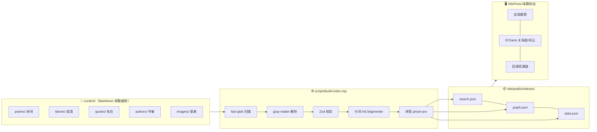

<div align="center">

# 万卷 wanjuan

**读书破万卷，下笔如有神**

中小学文学知识库 · 本地 Markdown 知识图谱 · 主动学习系统

[](LICENSE)
[](package.json)
[](https://vitepress.dev)
[](#-路线图)
[](#-数据来源与合规)

**中文** | [English](#-english-introduction)

</div>

---

## 这是什么

**万卷**是一个运行在你自己电脑上的中小学文学知识库：诗词、成语、名句以 **一个 Markdown 文件 = 一个实体** 的方式收录，通过 frontmatter 元数据构建**可点击的知识关系图**，并对齐**教育部课程标准**（小学 75 篇 + 初中 61 篇 + 高中 72 篇推荐背诵篇目）。

它不止是查询工具，更是一套**基于学习科学的主动学习系统**：间隔重复复习、检索式测验、意象枢纽页、课标覆盖画像——目标是让文学知识的**广度与深度**同时生长。

> 零远程依赖、零数据库：数据即文件，`git` 即版本，浏览器即引擎。

## ✨ 核心特性

| 能力 | 说明 | 阶段 |
|---|---|---|
| 🔍 全局搜索 | 中文分词全文检索 + 拼音/首字母（输入 `ssb` 搜到 `苏轼`）+ 字段过滤 | P0 |
| 🕸️ 知识关系图 | 作者-作品-意象-典故-成语互联，点击聚焦、下钻、回源 | P0 |
| ☁️ 主题词云 | 构建期词频统计，按朝代/学段/题材切换视角 | P0 |
| 🏷️ 双轨标签统计 | 文学本体轨（体裁/题材/意象）+ 课标轨（学段/任务群），treemap/旭日图 | P0 |
| 🔗 一键回源 | 每个页面、每个图谱节点跳回 Markdown 源文件（GitHub `editLink` + `vscode://` 双通道） | P0 |
| 📖 意象枢纽页 | 一象多情：义项、高频例句、朝代热度、相关典故 | P1 |
| 🔁 间隔重复复习 | FSRS 算法调度默写卡/释义卡/溯源卡，进度本地留存 | P1 |
| 📝 每日一卷 | 检索式测验（默写填空/意象连线），错题自动入复习队列 | P1 |
| 🧭 学习路径 | 意象线（月→柳→雁→舟）、情感线、手法线，按学段螺旋上升 | P1 |
| 🤖 问我的书库 | 本地 RAG 问答（Ollama 接口预留，回答强制附出处） | P2 |
| 🎮 飞花令/成语接龙 | 纯规则引擎，支持人机对战 | P2 |
| 📈 素养画像 | 朝代/体裁/意象/语义场四维雷达，薄弱点一键生成专题 | P2 |

## 🏗️ 架构



## 🚀 快速开始

```bash
git clone https://github.com/topbat/wanjuan.git
cd wanjuan
npm install

npm run build:index   # 构建 JSON 索引（中文日志：解析/校验/统计/图谱）
npm run dev           # 本地站点 http://localhost:5173 （改 Markdown 即时生效）

npm run build         # 全量构建 → site/.vitepress/dist/（可直接部署 GitHub Pages）
```

要求：Node ≥ 20。无任何远程服务依赖。

## 📁 目录结构

```
wanjuan/
├── content/            # 数据源：一切内容的唯一真相（Markdown + frontmatter）
│   ├── poems/          #   诗词（按朝代/作者分子目录）
│   ├── idioms/         #   成语
│   ├── quotes/         #   名句
│   ├── authors/        #   作者
│   └── imagery/        #   意象
├── scripts/            # 构建管线（中文生产级日志）
│   ├── lib/logger.mjs  #   日志组件（级别/耗时/摘要）
│   └── build-index.mjs #   扫描→校验→分词→拼音→索引
├── site/               # VitePress 站点（.vitepress 配置与自定义页面）
├── docs/               # 项目文档
│   └── data-model.md   # ★ 数据契约：frontmatter 规范 + 谓词白名单（动数据前必读）
├── design-proposals/   # UI 风格提案（评审期产物）
└── public/curriculum/  # 课标篇目映射数据（75+61+72）
```

## 📊 数据来源与合规

| 内容 | 来源 | 许可 | 说明 |
|---|---|---|---|
| 古诗文原文 | [chinese-poetry](https://github.com/chinese-poetry/chinese-poetry) 等 | MIT / 公有领域 | 古代作品原文已进入公版 |
| 成语词典 | 开源成语库（MIT/Apache-2.0） | 遵循原许可 | 收录时保留版权声明 |
| 课标篇目 | 教育部课程标准公开文件 | 官方文件引用 | 篇目清单属事实信息 |
| 人物关系 | [CBDB](https://chinesecbdb.hsites.harvard.edu) | 学术开放 | 按其规范注明版本与日期 |
| 注释/译文赏析 | 本项目自研 | CC-BY-4.0（随 Apache-2.0 代码分发） | AI 起稿 + 人工校对，页内标注"仅供参考" |

**红线**：不抓取古诗文网、百度汉语等站点的受版权保护内容；不出售教材原文编排。

## 🧠 为什么这样做（方法论依据）

- **间隔重复（FSRS）**：以难度/稳定性/可提取性三变量调度复习，同等保持率下复习次数更少；
- **检索练习与交错练习**：默写与混刷的长期记忆收益远高于重读；
- **双重编码**：词云、关系图、时间轴为文本知识提供视觉编码通道；
- **课标双轨标签**：对齐《义务教育语文课程标准（2022 年版）》核心素养与文化自信导向。

详见 `docs/`（调研报告与设计文档）。

## 🗺️ 路线图

- [x] **P0 · 地基期**（进行中）：数据契约 / 课标 208 篇映射 / 索引管线 / 搜索·词云·统计·关系图四件套 / 回源双通道
- [ ] **P1 · 学习系统期**：意象枢纽页 / FSRS 复习 / 每日一卷 / 学习路径 / 对比阅读 / 成语语义场 / 引用卡
- [ ] **P2 · 个人宇宙期**：本地 RAG 问答 / 素养画像 / 飞花令与接龙 / 时间轴与文学地图 / 年度回顾

## 🤝 贡献与引用

- 内容纠错：直接修改对应 `content/**.md` 并提交 PR（frontmatter 规范见 `docs/data-model.md`）；
- 引用本项目数据时请区分：**代码** Apache-2.0；**公版原文** 属公有领域；**自研注释译文** 遵循其标注许可；**第三方数据** 遵循其原始许可。

---

## 🇬🇧 English Introduction

**wanjuan** (万卷, "ten thousand scrolls") is a local-first knowledge base and learning system for Chinese literature taught in K-12: classical poems, idioms (chengyu) and famous quotes, each stored as **one Markdown file per entity** with structured frontmatter.

It builds a **clickable knowledge graph** (authors → works → imagery → allusions → idioms), aligned with the **Chinese national curriculum standards** (208 recommended recitation pieces across primary, junior and senior stages), and turns the corpus into an active learning system powered by learning science: FSRS spaced repetition, retrieval practice quizzes, imagery hub pages, and curriculum-coverage analytics.

Zero remote services, zero database — data as files, `git` as versioning, browser as engine. Built with VitePress, ECharts, and a Node-based build pipeline with production-grade Chinese logging.

**License**: Code under Apache-2.0; public-domain classics remain public domain; third-party datasets follow their original licenses.

<div align="center">

---

*万卷 —— 为终身学习而建 · Built for lifelong learning*

</div>
